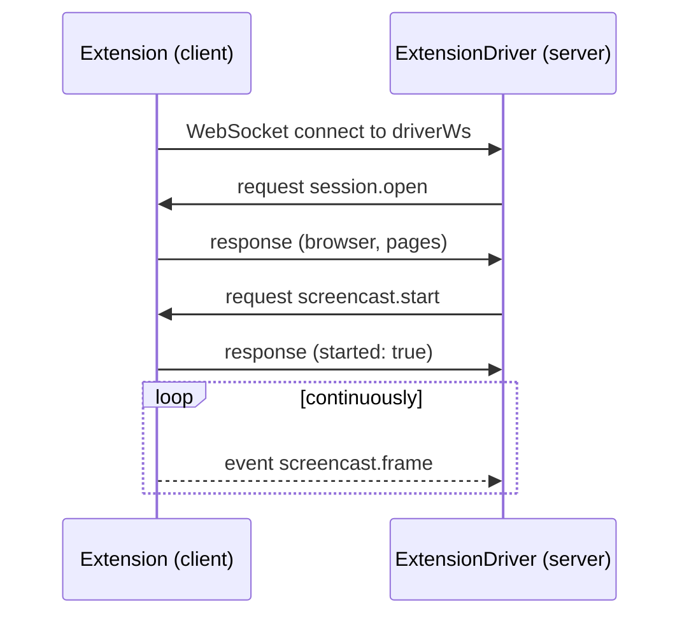
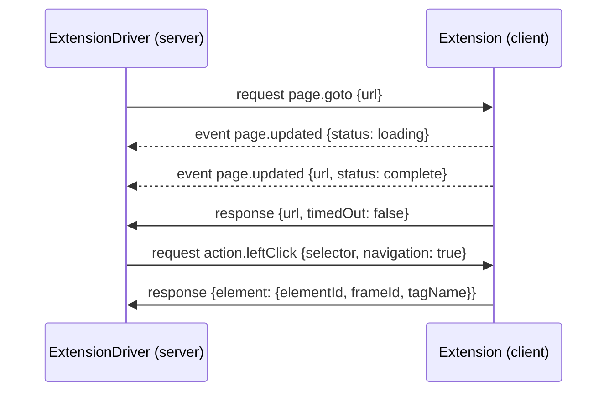
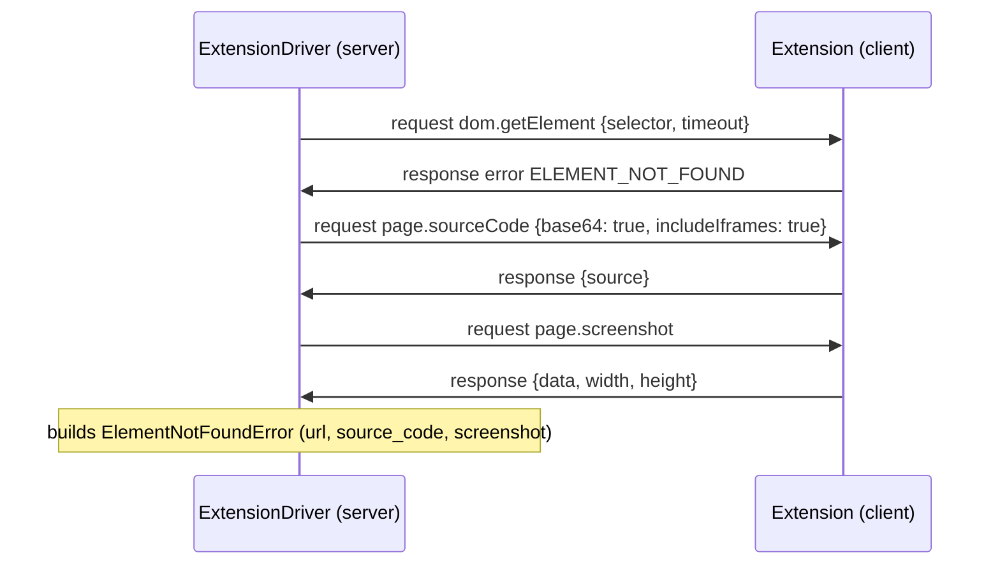
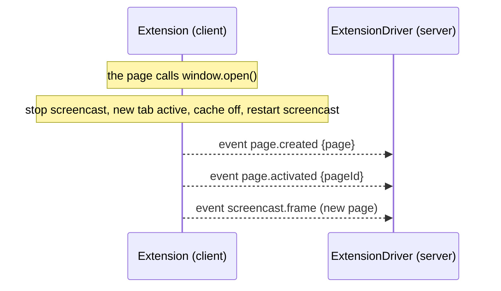

# WebSocket Protocol — ExtensionDriver

Protocol version: **1.0**

This document defines the communication protocol between:

- the **server**: the new `ExtensionDriver`, which replaces `PuppeteerDriver`;
- the **client**: the web extension that drives the remote browser.

Every public method of `PuppeteerDriver` has a dedicated message (see [§6 Mapping table](#6-driver--protocol-mapping-table)). The events emitted by the driver (`screenshot`, `screencast_error`) and those Puppeteer handled internally (`targetcreated`, `targetdestroyed`) are client → server events.

---

## Table of contents

1. [Principles](#1-principles)
2. [Transport, connection and handshake](#2-transport-connection-and-handshake)
3. [Message envelopes](#3-message-envelopes)
4. [Common types](#4-common-types)
5. [Error codes](#5-error-codes)
6. [Driver → protocol mapping table](#6-driver--protocol-mapping-table)
7. [Requests: server → client](#7-requests-server--client)
8. [Events: client → server](#8-events-client--server)
9. [Page (tab) management](#9-page-tab-management)
10. [Large payloads (chunking)](#10-large-payloads-chunking)
11. [Typical sequences](#11-typical-sequences)
12. [Extension-side implementation notes](#12-extension-side-implementation-notes)
13. [Findings in the current driver](#13-findings-in-the-current-driver)
14. [Security](#14-security)

---

## 1. Principles

1. **The server commands, the client executes.** The server sends a `request`; the client answers with a `response` carrying the same `id`.
2. **The client notifies.** Any unsolicited state change (new tab, URL change, screencast frame, download) is a client → server `event`.
3. **Atomic operations stay on the client.** Selector waits, polling, iframe lookups and clicks — anything that would need many round trips — run inside the extension. The server does no network polling.
4. **Business logic stays on the server.** `LoggableError`, `ElementNotFoundError`, diagnostic capture (url, source, screenshot), `assertPublicHttpsUrl` (SSRF) and the `startsWith('http')` check remain in `ExtensionDriver`.
5. **Protocol defaults.** Every parameter marked `?` is optional and uses the fixed defaults listed below when omitted.
6. **JSON only**, in UTF-8 text frames. Binary data (screenshots, PDFs, files) is **base64**, as in the current driver.
7. **Units**: durations in milliseconds; coordinates in CSS pixels relative to the top-level page viewport.

**Defaults**

```ts
const defaults = {
  timeout: 10000,
  navigationTimeout: 30000,
  downloadTimeout: 20000,
  delay: 1000,
  polling: 1000,
  viewport: { width: 1920, height: 1080 },
  maxMessageBytes: 1048576,
};
```

---

## 2. Transport, connection and handshake

### 2.1 Connection

- The extension **initiates** the connection (the remote browser is behind a NAT) using the random per-collect `driverWs` path returned by the credential collection endpoint.
- `wss://` is mandatory in production.
- `driverWs` is the path itself; it embeds a random per-collect route token. There is no `hello` message or token field in the WebSocket protocol. A wrong token produces an unregistered path, and the server checks the extension `Origin` header before accepting the connection.
- The server creates `driverWs` when `EXTENSION_ORIGIN` is configured to the exact `chrome-extension://<id>` origin.

### 2.2 Connection

```
Client                                   Server
  │── WebSocket connect ────────────────▶│
  │◀──────────────────── request session.open
  │── response ─────────────────────────▶│
  │           … active session …          │
```

The server closes a connection with code `4001` when the request Origin is not the configured extension Origin or production TLS requirements are not met.

### 2.3 Heartbeat

- Each side sends `ping` every **20 s**; the other side answers `pong` with the same `id`.
- No `pong` within 10 s: the connection is considered dead and is closed.
- This traffic also keeps the extension's MV3 service worker alive (see §12).

### 2.4 Reconnection

- On disconnection, the client reconnects to the same `driverWs` path with exponential backoff (1 s → 30 s). The server resumes the associated session by path.
- The server keeps the session for **30 s**. After that, the session is destroyed.
- Requests in flight at the time of the disconnection are rejected on the server side with the `DISCONNECTED` error. **They are never replayed automatically** (an action is not idempotent).
- After resuming, the server calls `page.list` to resynchronize its cache (§9).

---

## 3. Message envelopes

Every message has a `type` field.

```ts
type Message =
  | Request | Response
  | Event
  | Ping | Pong
  | Cancel
  | Bye;
```

### 3.1 `request` (server → client)

```ts
interface Request<P = unknown> {
  type: 'request';
  id: string;          // unique per session, generated by the server
  method: string;      // e.g. "page.goto" (§7)
  params: P;           // object, {} if there are no parameters
}
```

### 3.2 `response` (client → server)

```ts
interface ResponseOk<R = unknown> {
  type: 'response';
  id: string;
  ok: true;
  result: R;           // object, {} if there is no result
}

interface ResponseError {
  type: 'response';
  id: string;
  ok: false;
  error: {
    code: ErrorCode;   // §5
    message: string;
    data?: Record<string, unknown>;
  };
}
```

### 3.3 `event` (client → server)

```ts
interface Event<D = unknown> {
  type: 'event';
  event: string;       // e.g. "page.created" (§8)
  data: D;
  ts: number;          // client-side epoch ms
}
```

### 3.4 `ping` / `pong` (bidirectional)

```ts
interface Ping { type: 'ping'; id: string; ts: number }
interface Pong { type: 'pong'; id: string; ts: number }
```

### 3.5 `cancel` (server → client)

Asks the client to abort a running request (the server reached its own timeout). The client stops the operation if possible and answers `TIMEOUT`, or does not answer at all.

```ts
interface Cancel { type: 'cancel'; id: string }
```

### 3.6 `bye` (bidirectional)

```ts
interface Bye { type: 'bye'; code: string; reason?: string }
```

### 3.7 Processing rules

- **Server-side timeout** = the request's `params.timeout` + **10 s** margin (or `defaults.timeout + 10 s` if absent). On expiry: `cancel`, then local rejection.
- **Action serialization**: the server sends **only one action request at a time** per session. Read and diagnostic requests may go out in parallel: `page.url`, `page.origin`, `page.count`, `page.list`, `page.screenshot`, `page.sourceCode`, `screencast.start`, `screencast.stop`. A client that receives a second action in parallel answers `BUSY`.
- Unknown method: `UNKNOWN_METHOD`. Known method not implemented by this client: `UNSUPPORTED`.

---

## 4. Common types

```ts
/** CSS selector (same shape as in the driver). */
interface Selector {
  selector: string;        // CSS selector
  info?: string;           // human-readable description, used in error messages
}

/** Params shared by every page-related message. */
interface PageScoped {
  pageId?: string;         // default: the active page (§9)
}

/** Shared wait options. */
interface WaitOptions {
  timeout?: number;        // default: defaults.timeout
  raiseException?: boolean; // default: true
}

type WaitUntil = 'load' | 'domcontentloaded' | 'networkidle0' | 'networkidle2';

interface BrowserInfo {
  name: string;
  version: string;
  userAgent: string;
}

/** Reference to a live DOM element on the client side. */
interface ElementRef {
  elementId: string;       // opaque handle, valid until the frame navigates
  frameId: string;
  tagName: string;         // uppercase, e.g. "INPUT"
}

interface PageInfo {
  pageId: string;
  url: string;
  title: string;
  active: boolean;
  index: number;           // creation order (0 = first page)
}

interface ProxyConfig {
  scheme: 'http' | 'https' | 'socks4' | 'socks5';
  host: string;
  port: number;
  username?: string;
  password?: string;
  bypassList?: string[];
}
// To be aligned with the `Proxy` class (abstractProxy), which was not part of the reviewed source.

/** Cookie, Puppeteer-compatible format (round trip getCookies → setCookies). */
interface Cookie {
  name: string;
  value: string;
  domain: string;
  path: string;
  expires: number;         // epoch in seconds, -1 for a session cookie
  size?: number;
  httpOnly: boolean;
  secure: boolean;
  session?: boolean;
  sameSite?: 'Strict' | 'Lax' | 'None';
  priority?: 'Low' | 'Medium' | 'High';
  sameParty?: boolean;
  sourceScheme?: 'Unset' | 'NonSecure' | 'Secure';
  partitionKey?: string;
}

/** Downloaded file, transferred from the remote browser. */
interface FileInfo {
  name: string;
  size: number;
  mimeType?: string;
  data?: string;                    // base64 (small file)
  transfer?: { $transfer: string }; // otherwise, chunked transfer (§10)
}
```

---

## 5. Error codes

```ts
type ErrorCode =
  | 'PAGE_NOT_INITIALIZED'   // no active page
  | 'BROWSER_NOT_INITIALIZED'// session.open was not called
  | 'ELEMENT_NOT_FOUND'      // data: { selector, info? }
  | 'STALE_ELEMENT'          // outdated elementId (navigation, release, eviction)
  | 'TIMEOUT'                // data: { timeout }
  | 'NAVIGATION_FAILED'      // network error / net::ERR_*  (≠ timeout, see goto)
  | 'INVALID_URL'
  | 'INVALID_PARAMS'
  | 'TARGET_CLOSED'          // the targeted tab was closed during the operation
  | 'DEBUGGER_DETACHED'      // chrome.debugger detached (DevTools opened, crash…)
  | 'NO_FILE_DOWNLOADED'
  | 'SCREENCAST_ERROR'
  | 'PERMISSION_DENIED'      // missing permission or host permission
  | 'BUSY'                   // another action is in progress
  | 'UNKNOWN_METHOD'
  | 'UNSUPPORTED'
  | 'DISCONNECTED'           // generated on the server side only
  | 'INTERNAL';
```

**Error diagnostics.** The current driver attaches `url`, `source_code` and `screenshot` to errors. To avoid bloating every error response, the client **does not attach** them. After receiving an error, `ExtensionDriver` fetches them itself through `page.url`, `page.sourceCode` and `page.screenshot`, then builds `LoggableError` / `ElementNotFoundError`.

---

## 6. Driver → protocol mapping table

### 6.1 Public methods of `PuppeteerDriver`

| Driver method | Message (`method`) | Section |
|---|---|---|
| `open(locale, proxy)` | `session.open` | [7.1](#71-session) |
| `update(locale, proxy)` | `session.update` | [7.1](#71-session) |
| `close()` | `session.close` | [7.1](#71-session) |
| `startScreenCast()` | `screencast.start` | [7.2](#72-screencast) |
| `stopScreenCast()` | `screencast.stop` | [7.2](#72-screencast) |
| `url()` | `page.url` | [7.3](#73-pages-and-navigation) |
| `origin()` | `page.origin` | [7.3](#73-pages-and-navigation) |
| `numberOfPages()` | `page.count` | [7.3](#73-pages-and-navigation) |
| `closePage()` | `page.close` | [7.3](#73-pages-and-navigation) |
| `closeExtraPages()` | `page.closeExtra` | [7.3](#73-pages-and-navigation) |
| `goBack()` | `page.goBack` | [7.3](#73-pages-and-navigation) |
| `goto(url, opts)` | `page.goto` | [7.3](#73-pages-and-navigation) |
| `newPage(url)` | `page.new` | [7.3](#73-pages-and-navigation) |
| `waitForNavigation(opts)` | `page.waitForNavigation` | [7.3](#73-pages-and-navigation) |
| `sourceCode(base64, includeIframes)` | `page.sourceCode` | [7.4](#74-capture) |
| `screenshot()` | `page.screenshot` | [7.4](#74-capture) |
| `pdf()` | `page.pdf` | [7.4](#74-capture) |
| `getElement(selector, opts)` | `dom.getElement` | [7.5](#75-dom) |
| `getElementCoordinates(x, y)` | `dom.getElementAtPoint` | [7.5](#75-dom) |
| `getElements(selector, opts)` | `dom.getElements` | [7.5](#75-dom) |
| `getAttribute(selector, name, opts)` | `dom.getAttribute` | [7.5](#75-dom) |
| `getAttributes(selector, name, opts)` | `dom.getAttributes` | [7.5](#75-dom) |
| `leftClick(selector, opts)` | `action.leftClick` | [7.6](#76-actions-on-a-selector) |
| `inputText(selector, text, opts)` | `action.inputText` | [7.6](#76-actions-on-a-selector) |
| `dropdownSelect(selector, value, opts)` | `action.dropdownSelect` | [7.6](#76-actions-on-a-selector) |
| `click(x, y, opts)` | `input.click` | [7.7](#77-keyboard-and-mouse-input) |
| `press(key, opts)` | `input.press` | [7.7](#77-keyboard-and-mouse-input) |
| `type(text, opts)` | `input.type` | [7.7](#77-keyboard-and-mouse-input) |
| `getDownloadedFiles(clean)` | `download.list` | [7.8](#78-downloads) |
| `downloadFile(url)` | `download.fromUrl` | [7.8](#78-downloads) |
| `waitForFileToDownload(raise)` | `download.waitForFile` | [7.8](#78-downloads) |
| `waitForCloudflareTurnstile()` | `captcha.waitForCloudflareTurnstile` | [7.9](#79-captchas) |
| `waitForDatadomeCaptcha()` | `captcha.waitForDatadome` | [7.9](#79-captchas) |
| `getCookies(names)` | `cookies.get` | [7.10](#710-cookies-and-localstorage) |
| `setCookies(cookies)` | `cookies.set` | [7.10](#710-cookies-and-localstorage) |
| `getLocalStorage(keys)` | `localStorage.get` | [7.10](#710-cookies-and-localstorage) |
| `setLocalStorage(data)` | `localStorage.set` | [7.10](#710-cookies-and-localstorage) |

### 6.2 Element messages (`Element` class)

`getElement` and friends return an `Element`, whose methods (`element.leftClick`, `element.inputText`, `element.dropdownSelect`) are called by the rest of the code. They have `element.*` equivalents (see [7.11](#711-element-handles)).

### 6.3 Driver and Puppeteer events

| Origin | Protocol event |
|---|---|
| `emit('screenshot', data, w, h)` | `screencast.frame` |
| `emit('screencast_error', err)` | `screencast.error` |
| `browser.on('targetcreated')` | `page.created` |
| `browser.on('targetdestroyed')` | `page.closed` |
| (implicit, `this.page` changes) | `page.activated` |
| (keeping `url()` in sync) | `page.updated` |

### 6.4 Not exposed

- `pages()` (private): replaced by `page.list` (§7.3) for resynchronization.
- `waitFor(...)` (private): the polling done by `waitForFileToDownload` and `waitForDatadomeCaptcha` runs on the client side (dedicated messages).

### 6.5 `url()` and `origin()` are synchronous in the driver

`PuppeteerDriver.url(): string` and `origin(): string` are **synchronous** and are called everywhere (for example `goto` does `this.url().startsWith('http')`). A WebSocket round trip is asynchronous.

**Decision.** `ExtensionDriver` keeps a **local cache** of the active page's URL, fed by the `page.updated` event (the client emits it on every URL change, including `pushState`). `url()` and `origin()` read that cache synchronously. The `page.url` and `page.origin` messages exist for explicit resynchronization (after a reconnection, after `page.goto`) and for diagnostics.

---

## 7. Requests: server → client

In every table of this section:

- **Event** is the `method` value of the request (e.g. `page.goto`).
- **Request payload** is the content of `request.params`; **Response payload** is the content of `response.result` on success.
- `PageScoped` and `WaitOptions` are defined in [§4](#4-common-types). Every message that uses `PageScoped` accepts an optional `pageId`.
- `{}` means an empty object.
- Error codes are listed in the notes under each table.

### 7.1 Session

| Event | Comment | Request payload | Response payload |
|---|---|---|---|
| `session.open` | Equivalent of `open(locale, proxy)`. The browser already exists, so "opening" means applying the configuration and attaching control. | `{ locale: string; proxy: ProxyConfig \| null; options: SessionOptions }` | `{ browser: BrowserInfo; pages: PageInfo[]; activePageId: string \| null }` |
| `session.update` | Equivalent of `update(locale, proxy)`. Atomically re-opens the session with a new locale/proxy and restores cookies, localStorage and URL. | `{ locale: string; proxy: ProxyConfig \| null }` | `{ url: string; restored: boolean }` |
| `session.close` | Equivalent of `close()`. Stops the screencast and releases control. | `{ closeBrowser?: boolean }` | `{}` |

**`SessionOptions`**

```ts
interface SessionOptions {
  disableCache: boolean;                 // true: equivalent of page.setCacheEnabled(false)
  blockImages: boolean;                  // true when config.loadImages === false
  blockImagesAllowUrlContains: string[]; // e.g. ["cloudflare.com"]: exceptions to image blocking
  viewport: { width: number; height: number };
  clearDownloads: boolean;               // true: equivalent of the initial getDownloadedFiles(true)
}
```

**Notes**

- `session.open` — the client must: apply locale and proxy; disable the cache on every page, including pages created later; if `blockImages`, abort `image` requests whose URL contains none of the `blockImagesAllowUrlContains` strings; empty the downloads folder if `clearDownloads`; start emitting `page.*` events (§9).
- `session.update` — client-side sequence, identical to the driver:
  1. if the current URL starts with `http`: read cookies (`getCookies([])`) and localStorage (`getLocalStorage([])`);
  2. reset the session (like `session.close` without closing the browser);
  3. re-apply `session.open` with the new `locale` and `proxy` and the same `options` as at opening;
  4. if the URL was `http`: `setCookies`, `setLocalStorage`, then `goto(url)`.
  The server may also orchestrate this itself with `cookies.get`, `localStorage.get`, `session.close`, `session.open`, `cookies.set`, `localStorage.set`, `page.goto`. Both approaches are equivalent; `session.update` has the advantage of being atomic.
- `session.close` — the client stops the screencast, removes proxy/overrides/blocking rules, releases element handles and detaches the debugger. `closeBrowser` defaults to `false` (never close the user's browser); with `true`, it also closes the windows it opened.

### 7.2 Screencast

| Event | Comment | Request payload | Response payload |
|---|---|---|---|
| `screencast.start` | Equivalent of `startScreenCast()`. Stops any existing screencast first. Frames arrive as `screencast.frame` events. | `PageScoped & { format?: 'jpeg' \| 'png'; quality?: number; maxWidth?: number; maxHeight?: number; everyNthFrame?: number }` | `{ started: boolean; error?: string }` |
| `screencast.stop` | Equivalent of `stopScreenCast()`. Idempotent. | `{}` | `{}` |

**Notes**

- `screencast.start` defaults: `format` `'jpeg'`, `quality` `100` (0–100), `maxWidth`/`maxHeight` `defaults.viewport`, `everyNthFrame` `1`.
- As in the driver, a start failure (target gone) is **not** a request error: the client answers `started: false` **and** emits the `screencast.error` event. `PAGE_NOT_INITIALIZED` remains a real error.
- The client acknowledges frames to the browser itself (equivalent of `Page.screencastFrameAck`) and **drops** frames when `ws.bufferedAmount` exceeds a threshold, to avoid buffering.

### 7.3 Pages and navigation

| Event | Comment | Request payload | Response payload |
|---|---|---|---|
| `page.url` | Equivalent of `url()`. See [§6.5](#65-url-and-origin-are-synchronous-in-the-driver). | `PageScoped` | `{ url: string }` |
| `page.origin` | Equivalent of `origin()` (`new URL(url).origin`). Returns `"null"` for `about:blank`, like `new URL().origin`. | `PageScoped` | `{ origin: string }` |
| `page.count` | Equivalent of `numberOfPages()`. | `{}` | `{ count: number }` |
| `page.list` | *Added, not in the driver* (replaces the private `pages()`). Used for resynchronization. | `{}` | `{ pages: PageInfo[]; activePageId: string \| null }` |
| `page.close` | Equivalent of `closePage()`. Closes the targeted page (active by default). The new active page follows the rule in [§9](#9-page-tab-management); the client emits `page.closed` then `page.activated`. | `PageScoped` | `{ activePageId: string \| null }` |
| `page.closeExtra` | Equivalent of `closeExtraPages()`. Keeps the first page (index 0) and closes all others. Answers only once every page is closed. | `{}` | `{ closed: number; activePageId: string \| null }` |
| `page.goBack` | Equivalent of `goBack()`. Fixed `networkidle0` wait. A timeout is **not** an error (`timedOut: true`). An empty history is not an error either (`url` unchanged). | `PageScoped & { timeout?: number }` | `{ url: string; timedOut: boolean }` |
| `page.goto` | Equivalent of `goto(url, { timeout, navigation })`. A timeout is swallowed (`timedOut: true`). | ```PageScoped & { url: string; timeout?: number; waitUntil?: WaitUntil }``` | `{ url: string; timedOut: boolean }` |
| `page.new` | Equivalent of `newPage(url)`. Opens a new tab, makes it active, then navigates like `goto`. | `{ url: string; timeout?: number; waitUntil?: WaitUntil }` | `{ pageId: string; url: string; timedOut: boolean }` |
| `page.waitForNavigation` | Equivalent of `waitForNavigation({ timeout })`. Waits for the next navigation (`networkidle0`). The timeout is swallowed, like in the driver. | `PageScoped & { timeout?: number }` | `{ timedOut: boolean }` |

**Notes**

- `timeout` defaults: `defaults.navigationTimeout` for `page.goBack`, `page.goto`, `page.new`; `defaults.timeout` for `page.waitForNavigation`.
- `page.goto` — mapping with the driver: `navigation: true` (default) ↔ `waitUntil: 'networkidle0'` (default); `navigation: false` ↔ `waitUntil: 'domcontentloaded'`. Serious network errors (`net::ERR_*`) give `NAVIGATION_FAILED`. **The server** then checks that `result.url` starts with `http` (otherwise `Error("Invalid URL: <url>")`) and rejects `url === undefined` before sending anything.
- `page.new` — the new tab becomes active, following the rules in [§9](#9-page-tab-management).
- `page.close`, `page.closeExtra`, `page.goBack`, `page.goto` and `page.new` return `PAGE_NOT_INITIALIZED` when there is no page to act on.

### 7.4 Capture

| Event | Comment | Request payload | Response payload |
|---|---|---|---|
| `page.sourceCode` | Equivalent of `sourceCode(base64, includeIframes)`. Cleaning is done **on the client** to reduce the transferred volume. May exceed `maxMessageBytes` (see [§10](#10-large-payloads-chunking)). | `PageScoped & { base64: boolean; includeIframes: boolean }` | `{ source: string; base64: boolean }` |
| `page.screenshot` | Equivalent of `screenshot()`. The server rebuilds the driver's `Screenshot` object (`{ data, width, height }`). | `PageScoped & { format?: 'png' \| 'jpeg' }` | `{ data: string; width: number; height: number; mimeType: string }` |
| `page.pdf` | Equivalent of `pdf()` (`scale: 1`, `format: 'A4'`, `printBackground: true` by default). To be validated on the extension side (see [§12](#12-extension-side-implementation-notes)). | `PageScoped & { format?: string; scale?: number; printBackground?: boolean }` | `{ data: string }` |

**Notes**

- `page.sourceCode` — same rules as the driver:
  - if the current URL does not start with `http`: `source: ""`;
  - `includeIframes: false`: main frame only; otherwise all frames;
  - scripts, SVGs, styles, `<head>` and iframes are removed from each frame's HTML;
  - an unreadable frame gives `<!-- Unable to retrieve frame content. Error: <error> -->`;
  - frames are joined with `\n<!-- ========== FRAME SEPARATOR ========== -->\n`;
  - `source` is already base64-encoded when `base64` is `true`.
- `page.screenshot` — `format` defaults to `'png'` (Puppeteer's default). `data` is base64. `width`/`height` are the viewport size (default: `defaults.viewport`).
- `page.pdf` — `format` defaults to `'A4'`, `scale` to `1`, `printBackground` to `true`. `data` is base64.

### 7.5 DOM

`dom.*` and `action.*` messages search **all frames** of the page, including nested iframes, like `getElement` in the driver (`Promise.any` over `page.frames()`).

| Event | Comment | Request payload | Response payload |
|---|---|---|---|
| `dom.getElement` | Equivalent of `getElement(selector, { raiseException, timeout })`. Waits for the **first** matching element in any frame. Presence in the DOM is enough (visibility not required), like the default `waitForSelector`. | `PageScoped & WaitOptions & { selector: Selector }` | `{ element: ElementRef \| null }` |
| `dom.getElementAtPoint` | Equivalent of `getElementCoordinates(x, y)`. Deepest element at the point, through shadow roots and nested iframes. | `PageScoped & { x: number; y: number }` | `{ element: ElementRef \| null }` |
| `dom.getElements` | Equivalent of `getElements(selector, opts)`. First waits for one element (like `dom.getElement`), then returns all matching elements. | `PageScoped & WaitOptions & { selector: Selector; frames?: 'main' \| 'all' }` | `{ elements: ElementRef[] }` |
| `dom.getAttribute` | Equivalent of `getAttribute(selector, attributeName, opts)`. Returns `el.getAttribute(attr) ?? el[attr]` (HTML attribute, otherwise JS property). | `PageScoped & WaitOptions & { selector: Selector; attributeName: string }` | `{ value: string \| boolean \| number \| null }` |
| `dom.getAttributes` | Equivalent of `getAttributes(selector, attributeName, opts)`. Same attribute/property rule as `dom.getAttribute`, for every matching element. | `PageScoped & WaitOptions & { selector: Selector; attributeName: string; frames?: 'main' \| 'all' }` | `{ values: Array<string \| boolean \| number \| null> }` |

**Notes**

- `dom.getElement` — element not found after `timeout`: `ELEMENT_NOT_FOUND` (`data: { selector, info? }`) if `raiseException`, otherwise `element: null`.
- `dom.getElementAtPoint` — `x`/`y` in CSS px relative to the top-level viewport. Algorithm (identical to the driver):
  1. `elementFromPoint(x, y)`, descending into open **shadow roots**;
  2. if the element is an `<iframe>`: subtract the iframe's position (`boundingBox`) from `(x, y)` and start again inside that frame;
  3. otherwise, that element is the result.
  `x = 0` or `y = 0` are valid coordinates (see [§13](#13-findings-in-the-current-driver)).
- `dom.getElements` and `dom.getAttributes` — `frames` defaults to `'main'` (current behavior, see §13); `'all'` searches every frame.
- `dom.getAttribute` — `value` is `""` when the element is absent and `raiseException` is `false`. Element absent and `raiseException: true`: `ELEMENT_NOT_FOUND`.

### 7.6 Actions on a selector

These three messages combine the element lookup and the action in a single request. They are the equivalent of `getElement(...)` followed by `element.<action>(...)` in the driver.

| Event | Comment | Request payload | Response payload |
|---|---|---|---|
| `action.leftClick` | Equivalent of `leftClick(selector, opts)`. | `PageScoped & WaitOptions & { selector: Selector; delay?: number; navigation?: boolean; mouseHover?: boolean \| string }` | `{ element: ElementRef \| null }` |
| `action.inputText` | Equivalent of `inputText(selector, text, opts)`. `text` may contain a secret: do not log it ([§14](#14-security)). | `PageScoped & WaitOptions & { selector: Selector; text: string; delay?: number; tries?: number; navigation?: boolean; mouseHover?: boolean }` | `{ element: ElementRef \| null }` |
| `action.dropdownSelect` | Equivalent of `dropdownSelect(selector, value, opts)`. Selects an option of a `<select>`. Here `timeout` only applies to the element lookup. | `PageScoped & WaitOptions & { selector: Selector; value: string; delay?: number; mouseHover?: boolean }` | `{ element: ElementRef \| null }` |

**Notes**

- Defaults: `delay` `defaults.delay`; `navigation` `true` for `action.leftClick`, `false` for `action.inputText`; `mouseHover` `false`; `tries` `5`.
- `element` is `null` when the element is not found and `raiseException` is `false`.
- The semantics of the options is inferred from the driver's signatures. **To be aligned with `element.ts`, which was not part of the reviewed source.**
- Input events MUST be **trusted** (`isTrusted: true`), see [§12](#12-extension-side-implementation-notes).

| Option | Meaning |
|---|---|
| `timeout` | wait for the element (and for the navigation if `navigation`) |
| `delay` | pause in ms after the action |
| `navigation` | if `true`, waits for the end of a navigation triggered by the action; the absence of navigation is not an error |
| `mouseHover` | if `true`, moves the mouse over the element before acting |
| `tries` | (`inputText`) number of typing attempts, with verification of the value |

### 7.7 Keyboard and mouse input

These three messages act on the page, without a selector. Trusted events are required ([§12](#12-extension-side-implementation-notes)).

| Event | Comment | Request payload | Response payload |
|---|---|---|---|
| `input.click` | Equivalent of `click(x, y, { delay })`. Left click at the coordinates, then a pause of `delay`. Coordinates are CSS px in the top-level viewport. | `PageScoped & { x: number; y: number; delay?: number }` | `{}` |
| `input.press` | Equivalent of `press(key, { delay })`. `key` follows Puppeteer's `KeyInput` names (e.g. `"Enter"`, `"Tab"`, `"ArrowDown"`, `"KeyA"`), US layout. | `PageScoped & { key: string; delay?: number }` | `{}` |
| `input.type` | Equivalent of `type(text, { delay })`. Types the text character by character into the focused element, then pauses for `delay`. `text` may contain a secret: do not log it ([§14](#14-security)). | `PageScoped & { text: string; delay?: number }` | `{}` |

`delay` defaults to `defaults.delay`.

### 7.8 Downloads

Downloaded files live on the remote browser's machine. **The client sends them back to the server** (content as base64 or in chunks). `ExtensionDriver` then writes them to a local folder and returns paths, to respect the driver's `string` / `string[]` signatures.

| Event | Comment | Request payload | Response payload |
|---|---|---|---|
| `download.list` | Equivalent of `getDownloadedFiles(clean)`. | `{ clean?: boolean; includeContent?: boolean }` | `{ files: FileInfo[] }` |
| `download.fromUrl` | Equivalent of `downloadFile(url)`. Navigates the page to the URL and waits for the resulting file. | `PageScoped & { url: string; timeout?: number }` | `{ file: FileInfo }` |
| `download.waitForFile` | Equivalent of `waitForFileToDownload(raiseException)`. Waits for the first downloaded file, returns it and removes it from the client's folder (`clean: true`). | `{ raiseException?: boolean; timeout?: number }` | `{ file: FileInfo \| null }` |

**Notes**

- `download.list` — `clean` defaults to `true` (deletes the files on the client after reading); `includeContent` defaults to `true` (`false`: metadata only, `data` absent). With `clean: true` and `includeContent: false`, files are deleted **without** being transferred: a client MUST reject that combination (`INVALID_PARAMS`) unless the server asked for it explicitly, to avoid losing a file by mistake.
- `download.fromUrl` — `timeout` defaults to `defaults.downloadTimeout`. Sequence:
  1. **Server**: `assertPublicHttpsUrl(url)` (SSRF guard). The client cannot reliably resolve DNS, so it does not replace this check;
  2. **Client**: checks the `https:` scheme (defense in depth, `INVALID_URL` otherwise);
  3. **Client**: empties its downloads folder;
  4. **Client**: runs `location.href = url` in the page;
  5. **Client**: waits for the file (like `download.waitForFile`);
  6. `NO_FILE_DOWNLOADED` if nothing arrives before `timeout`.
- `download.waitForFile` — `raiseException` defaults to `true`; `timeout` defaults to `defaults.downloadTimeout`. Timeout: `NO_FILE_DOWNLOADED` if `raiseException`, otherwise `file: null`. See [§13](#13-findings-in-the-current-driver): the current driver still throws when `raiseException=false`; `ExtensionDriver` must decide whether to reproduce that.

### 7.9 Captchas

| Event | Comment | Request payload | Response payload |
|---|---|---|---|
| `captcha.waitForCloudflareTurnstile` | Equivalent of `waitForCloudflareTurnstile()`. Waits for `input[name='cf-turnstile-response'][value]` to appear in any frame, without raising an error. | `PageScoped & { timeout?: number }` | `{ found: boolean }` |
| `captcha.waitForDatadome` | Equivalent of `waitForDatadomeCaptcha()`. Polls until `iframe[title='DataDome Device Check']` **disappears** from the page. | `PageScoped & { timeout?: number; polling?: number }` | `{ success: true }` |

**Notes**

- `captcha.waitForCloudflareTurnstile` — `timeout` defaults to `defaults.timeout`.
- `captcha.waitForDatadome` — `timeout` defaults to `15000` (the value hard-coded in the driver); `polling` defaults to `defaults.polling`. Failure: `TIMEOUT` error (message: `Datadome captcha did not succeed`). The server adds the diagnostics.

### 7.10 Cookies and localStorage

| Event | Comment | Request payload | Response payload |
|---|---|---|---|
| `cookies.get` | Equivalent of `getCookies(namesToGet)`. Reads **all cookies of the browser**, not only those of the current page (see [§14](#14-security)). | `{ names?: string[] }` | `{ cookies: Cookie[] }` |
| `cookies.set` | Equivalent of `setCookies(cookies)`. `null`, `undefined` or an empty array: no-op. | `{ cookies: Cookie[] \| null }` | `{ count: number }` |
| `localStorage.get` | Equivalent of `getLocalStorage(keysToGet)`. Reads the `localStorage` of the page's origin. | `PageScoped & { keys?: string[] }` | `{ data: Record<string, string> }` |
| `localStorage.set` | Equivalent of `setLocalStorage(data)`. Like `evaluateOnNewDocument`, it **registers** a script that runs before the page's scripts on every **future** document loaded in that page. It does not write into the current document. | `PageScoped & { data: Record<string, unknown> \| null }` | `{}` |

**Notes**

- `cookies.get` — `names` absent → `[]`; `[]` → all cookies; otherwise filter `cookie.name.includes(x)`.
- `localStorage.get` — `keys` absent → `{}`; `[]` → everything; otherwise filter `key.includes(x)`. Returns `{}` if the origin is opaque (`about:blank`…).
- `localStorage.set` — values are converted with `String()`. `null` or empty: no-op.

### 7.11 Element handles

These messages correspond to the methods of the `Element` class returned by `getElement` & co. They target an `elementId` that was already obtained. Each message's options mirror those of its `action.*` equivalent. An outdated element gives `STALE_ELEMENT`.

| Event | Comment | Request payload | Response payload |
|---|---|---|---|
| `element.leftClick` | Equivalent of `Element.leftClick(opts)`. | `{ elementId: string; timeout?: number; delay?: number; navigation?: boolean; mouseHover?: boolean \| string }` | `{}` |
| `element.inputText` | Equivalent of `Element.inputText(text, opts)`. `text` may contain a secret: do not log it ([§14](#14-security)). | `{ elementId: string; text: string; tries?: number; timeout?: number; delay?: number; navigation?: boolean; mouseHover?: boolean }` | `{}` |
| `element.dropdownSelect` | Equivalent of `Element.dropdownSelect(value, opts)`. | `{ elementId: string; value: string; delay?: number; mouseHover?: boolean }` | `{}` |
| `element.middleClick` | Equivalent of `Element.middleClick(opts)`. | `{ elementId: string; useFallbackMethod?: boolean; timeout?: number; delay?: number; mouseHover?: boolean \| string }` | `{ usedFallback: boolean }` |
| `element.getElement` | Finds a descendant of an existing handle. | `{ elementId: string; selector: Selector; raiseException?: boolean }` | `{ element: ElementRef \| null }` |
| `element.getAttribute` | Reads an attribute or property from a descendant. | `{ elementId: string; selector: Selector; attributeName: string }` | `{ value: string \| boolean \| number \| null }` |
| `element.textContent` | Reads text content of the handle. | `{ elementId: string }` | `{ value: string \| null }` |
| `element.innerHTML` | Reads inner HTML of the handle. | `{ elementId: string }` | `{ value: string }` |
| `element.cssSelector` | Returns a CSS selector for the handle. | `{ elementId: string }` | `{ selector: string }` |
| `element.isClickable` | Checks visibility and disabled state. | `{ elementId: string }` | `{ clickable: boolean }` |
| `element.release` | *Added, not in the driver.* Releases handles. | `{ elementIds: string[] }` | `{ released: number }` |

**Notes**

- Defaults: `navigation` `true` for `element.leftClick`, `false` for `element.inputText`; `tries` `5`; `mouseHover` `false`.
- `element.release` — Puppeteer releases handles through garbage collection; here the client keeps a bounded registry (**1000** elements, LRU eviction), purged on every navigation of the concerned frame.
- If the `Element` class exposes other methods than those used in `puppeteerDriver.ts` (reading text, `boundingBox`, `evaluate`…), the matching `element.*` messages must be added.

---

## 8. Events: client → server

In every table of this section, **Event** is the `event` value of the message (e.g. `page.created`) and **Event payload** is the content of `event.data`.

### 8.1 Pages

| Event | Comment | Event payload |
|---|---|---|
| `page.created` | New tab (equivalent of `targetcreated` with a page). **Before** emitting the event, the client applies the rules in [§9](#9-page-tab-management): the page becomes active, is brought to the front, its cache is disabled and the screencast moves to it. | `{ page: PageInfo; openerPageId?: string }` |
| `page.closed` | Tab closed (equivalent of `targetdestroyed`). | `{ pageId: string; activePageId: string \| null }` |
| `page.activated` | The active page changed (after a creation, a closure, or `page.close`). | `{ pageId: string }` |
| `page.updated` | URL, title or loading state of a page changed (including `pushState` and SPA navigations). Feeds the synchronous `url()` cache ([§6.5](#65-url-and-origin-are-synchronous-in-the-driver)). | `{ pageId: string; url?: string; title?: string; status?: 'loading' \| 'complete' }` |
| `page.error` | Unsolicited error on a page: debugger detached (DevTools opened, tab crash…). | `{ pageId: string; code: 'DEBUGGER_DETACHED' \| 'TARGET_CLOSED' \| 'INTERNAL'; message: string }` |

### 8.2 Screencast

| Event | Comment | Event payload |
|---|---|---|
| `screencast.frame` | Equivalent of `emit('screenshot', data, width, height)`. `width` and `height` are the size of the viewport, i.e. the coordinate space of `input.click`, like `AbstractDriver.VIEWPORT_WIDTH/HEIGHT` in the driver. | `{ pageId: string; data: string; width: number; height: number }` (`data`: base64, jpeg by default) |
| `screencast.error` | Equivalent of `emit('screencast_error', err)`. | `{ pageId?: string; message: string }` |

### 8.3 Downloads

| Event | Comment | Event payload |
|---|---|---|
| `download.started` | *Added, not in the driver.* Useful for diagnostics and to avoid polling on the server. | `{ name: string; url: string }` |
| `download.completed` | *Added, not in the driver.* Same purpose as `download.started`. | `{ name: string; size: number }` |

### 8.4 Transfer and client

| Event | Comment | Event payload |
|---|---|---|
| `transfer.chunk` | One fragment of a large payload. See [§10](#10-large-payloads-chunking). | `{ transferId: string; index: number; total: number; data: string }` |
| `client.log` | Extension log, for centralized diagnostics. It must never contain a `text` value, a cookie or an authorization header. | `{ level: 'debug' \| 'info' \| 'warn' \| 'error'; message: string }` |

---

## 9. Page (tab) management

The current driver tracks a "current page" (`this.page`) that `targetcreated` and `targetdestroyed` update. This logic is **replicated in the client**, to stay responsive and consistent even if the server is slow or disconnected. The server follows the state through the `page.*` events.

**Client rules:**

1. **Creation** of a page (through `page.new`, `window.open`, a click on a `target=_blank` link…):
   - if a screencast is running, stop it on the current page;
   - the new page becomes **active** and is brought to the front;
   - its cache is disabled;
   - if a screencast was running, it restarts on the new page;
   - emit `page.created`, then `page.activated`.
2. **Closure** of the active page:
   - stop the screencast if it is running;
   - the new active page is the **last remaining page** (`pages[pages.length - 1]`);
   - restart the screencast on it if it was running;
   - emit `page.closed` (with `activePageId`), then `page.activated`.
3. **Closure** of a non-active page: emit `page.closed`, with no change of the active page.
4. A request without `pageId` always targets the **page that is active at processing time**. A server that wants to avoid any race between two tabs MUST pass `pageId` explicitly.
5. A request with a non-existent `pageId` gets `TARGET_CLOSED`.

---

## 10. Large payloads (chunking)

Some results may exceed `defaults.maxMessageBytes`: `page.sourceCode`, `page.pdf`, `page.screenshot`, downloaded files.

If the field to return exceeds that threshold, the client replaces it in `result` with a `{ "$transfer": "<transferId>" }` marker, then sends the chunks as events **before** the response:

```ts
// event "transfer.chunk"
{
  transferId: string;
  index: number;             // 0-based
  total: number;
  data: string;              // fragment of the string (base64 or text)
}
```

The server reassembles the chunks (in `index` order, with no gap) and then substitutes the value. A missing chunk, or a transfer that is still incomplete 30 s after the response, gives an `INTERNAL` error on the server side.

Example:

```jsonc
// client → server (n times)
{ "type": "event", "event": "transfer.chunk", "ts": 1760000000000,
  "data": { "transferId": "t42", "index": 0, "total": 3, "data": "JVBERi0x..." } }

// client → server (final response)
{ "type": "response", "id": "17", "ok": true,
  "result": { "data": { "$transfer": "t42" } } }
```

---

## 11. Typical sequences

### 11.1 Opening a session



### 11.2 Navigation then click



### 11.3 Element not found



### 11.4 A tab opened by the page



---

## 12. Extension-side implementation notes

These are not protocol constraints, but points that determine its feasibility.

1. **Trusted events.** `dispatchEvent` from a content script produces `isTrusted: false`, which Cloudflare and Datadome detect. All clicks, keystrokes and hovers (`action.*`, `input.*`, `element.*`) must go through `chrome.debugger` (`Input.dispatchMouseEvent`, `Input.dispatchKeyEvent`, `Input.insertText`).
2. **`chrome.debugger`.** It shows a "debugging in progress" banner in the browser, accepts only one client per tab (conflict with DevTools → `DEBUGGER_DETACHED`), and also provides `Page.startScreencast`, `Page.captureScreenshot`, `Emulation.setLocaleOverride` and the `Fetch` domain (image blocking).
3. **Debugging detection.** The driver uses `rebrowser-puppeteer-core`, which patches the `Runtime.enable` leak. With `chrome.debugger`, avoid `Runtime.enable` and run page code through content scripts (isolated world) or `Page.createIsolatedWorld`.
4. **`networkidle0`.** Implement with the debugger's lifecycle events (`Page.lifecycleEvent` / `networkIdle`) or by counting in-flight requests (0 requests for 500 ms), to reproduce Puppeteer's behavior.
5. **Downloads.** An extension **cannot read** a file downloaded to disk (`chrome.downloads` gives no access to the content). Recommended approach: intercept `chrome.downloads.onCreated`, cancel the download, redo a `fetch(url)` from the service worker (cookies included) and keep the `Blob` in memory for `download.list` / `download.waitForFile`. Limits: POST requests and `blob:` URLs need separate handling.
6. **MV3 service worker.** It can be suspended after 30 s of inactivity; WebSocket activity (Chrome 116+) keeps it alive, hence the `ping` every 20 s.
7. **Locale and proxy.** Locale: `Emulation.setLocaleOverride` and `Network.setUserAgentOverride` (`acceptLanguage`). Proxy: `chrome.proxy.settings.set`, with authentication through `chrome.webRequest.onAuthRequired` (`webRequestAuthProvider` permission).
8. **Image blocking.** Through the debugger's `Fetch` domain (allows the driver's `url.includes('cloudflare.com')` test); `declarativeNetRequest` can only filter by domain.
9. **`page.pdf`.** `Page.printToPDF` is not guaranteed in non-headless Chrome through `chrome.debugger`. **To be validated early**; otherwise plan for `UNSUPPORTED`.
10. **Cross-origin frames.** Content scripts must be injected in all frames (`all_frames`, `match_about_blank`) so that `dom.getElement` and `dom.getElementAtPoint` can see nested iframes.
11. **Likely manifest permissions**: `debugger`, `tabs`, `cookies`, `downloads`, `webNavigation`, `webRequest`, `webRequestAuthProvider`, `proxy`, `scripting`, `storage`, and `host_permissions: ["<all_urls>"]`.

---

## 13. Findings in the current driver

The protocol fixes a behavior for each of these. It is up to you to decide whether to reproduce or fix them.

1. **`waitForFileToDownload(raiseException = false)` still throws.** `waitFor` returns `null`, then the method always throws a `LoggableError`. The protocol returns `file: null` and lets the server decide.
2. **`getElements` / `getAttributes` only search the main frame**, whereas `getElement` waits across all frames. The `frames` parameter (default `'main'`) reproduces the current behavior and allows switching to `'all'`.
3. **`getElementCoordinates`: `!frameBoundingBox?.x`** throws when the iframe's position is `0` (a valid value). The protocol treats `0` as valid.
4. **`closeExtraPages`: `forEach(async …)`** does not wait for the pages to actually close. `page.closeExtra` only answers once all pages are closed.
5. **`click`, `press`, `type`, `getLocalStorage` and `setLocalStorage`** use `this.page?.` and silently do nothing (or return `undefined`) when there is no page. The protocol returns `PAGE_NOT_INITIALIZED` for every page-scoped message.
6. **`getCookies` reads all cookies of the browser**, not only those of the page. Kept as is (see §14).

---

## 14. Security

- **Connection access**: the server checks `wss://` in production and the exact `chrome-extension://<id>` Origin. Each collect gets a path containing a cryptographically random route token; only the authorized API caller should receive it. A wrong token does not match a registered WebSocket path. Treat the path as confidential because it may appear in access logs.
- **Dedicated profile**: `cookies.get` with `names: []` returns every cookie of the browser. The extension must only be installed in a **dedicated profile**, never in a user's personal browser.
- **Secrets**: `params.text` of `action.inputText`, `input.type` and `element.inputText`, cookie values and `localStorage` content must appear in **no log** (server, extension, `client.log`).
- **SSRF**: `download.fromUrl` is validated on the server (`assertPublicHttpsUrl`) and the client refuses any scheme other than `https:`. For `page.goto`, the current driver only checks the result (`startsWith('http')`). The protocol does not change that.
- **Method support**: the client may answer `UNSUPPORTED` for methods it does not implement. A server should only send methods defined by this protocol version.
- **Size**: the client rejects incoming messages above a reasonable limit (`maxMessageBytes` × 2), and the server does the same for incoming messages.
- **Origin**: the server checks the connection's `Origin` header (`chrome-extension://<id>`).

---

## Appendix — Message summary

**Server → client (requests)**: `session.open`, `session.update`, `session.close`, `screencast.start`, `screencast.stop`, `page.url`, `page.origin`, `page.count`, `page.list`, `page.close`, `page.closeExtra`, `page.goBack`, `page.goto`, `page.new`, `page.waitForNavigation`, `page.sourceCode`, `page.screenshot`, `page.pdf`, `dom.getElement`, `dom.getElementAtPoint`, `dom.getElements`, `dom.getAttribute`, `dom.getAttributes`, `action.leftClick`, `action.inputText`, `action.dropdownSelect`, `input.click`, `input.press`, `input.type`, `download.list`, `download.fromUrl`, `download.waitForFile`, `captcha.waitForCloudflareTurnstile`, `captcha.waitForDatadome`, `cookies.get`, `cookies.set`, `localStorage.get`, `localStorage.set`, `element.leftClick`, `element.inputText`, `element.dropdownSelect`, `element.release`.

**Server → client (control)**: `ping`, `pong`, `cancel`, `bye`.

**Client → server (responses and control)**: `response`, `ping`, `pong`, `bye`.

**Client → server (events)**: `page.created`, `page.closed`, `page.activated`, `page.updated`, `page.error`, `screencast.frame`, `screencast.error`, `download.started`, `download.completed`, `transfer.chunk`, `client.log`.
